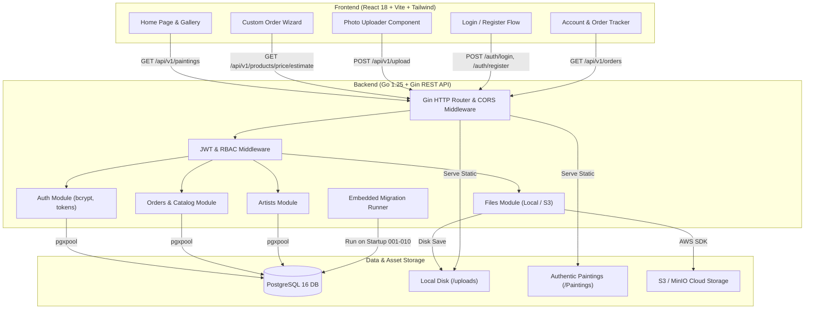
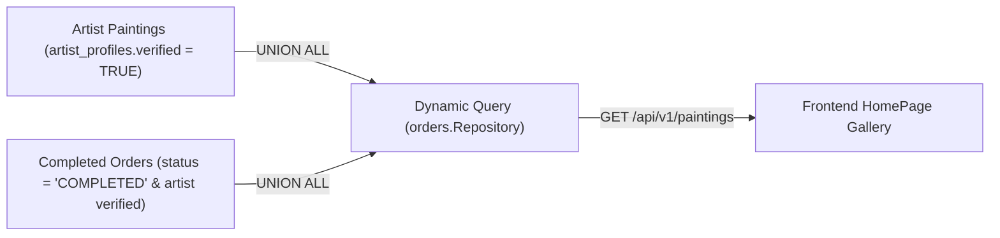
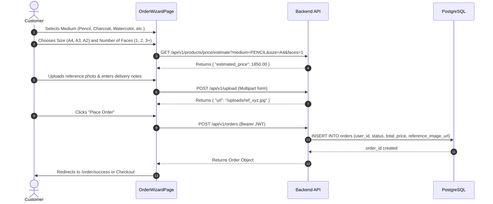
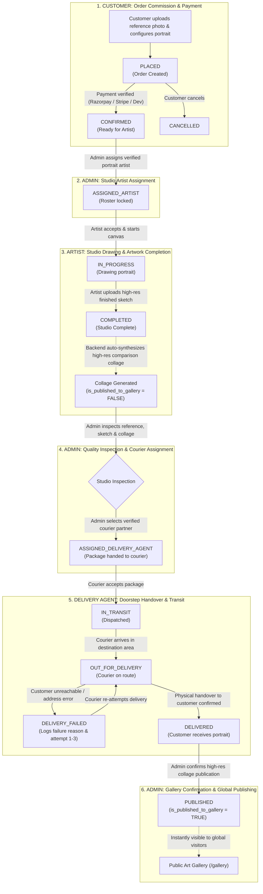
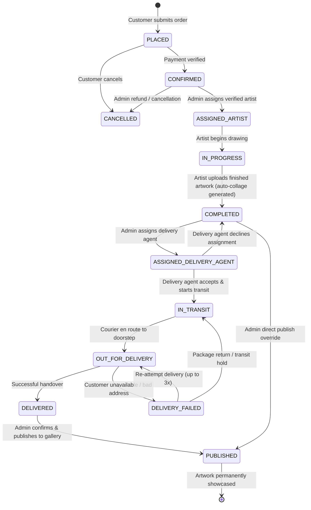
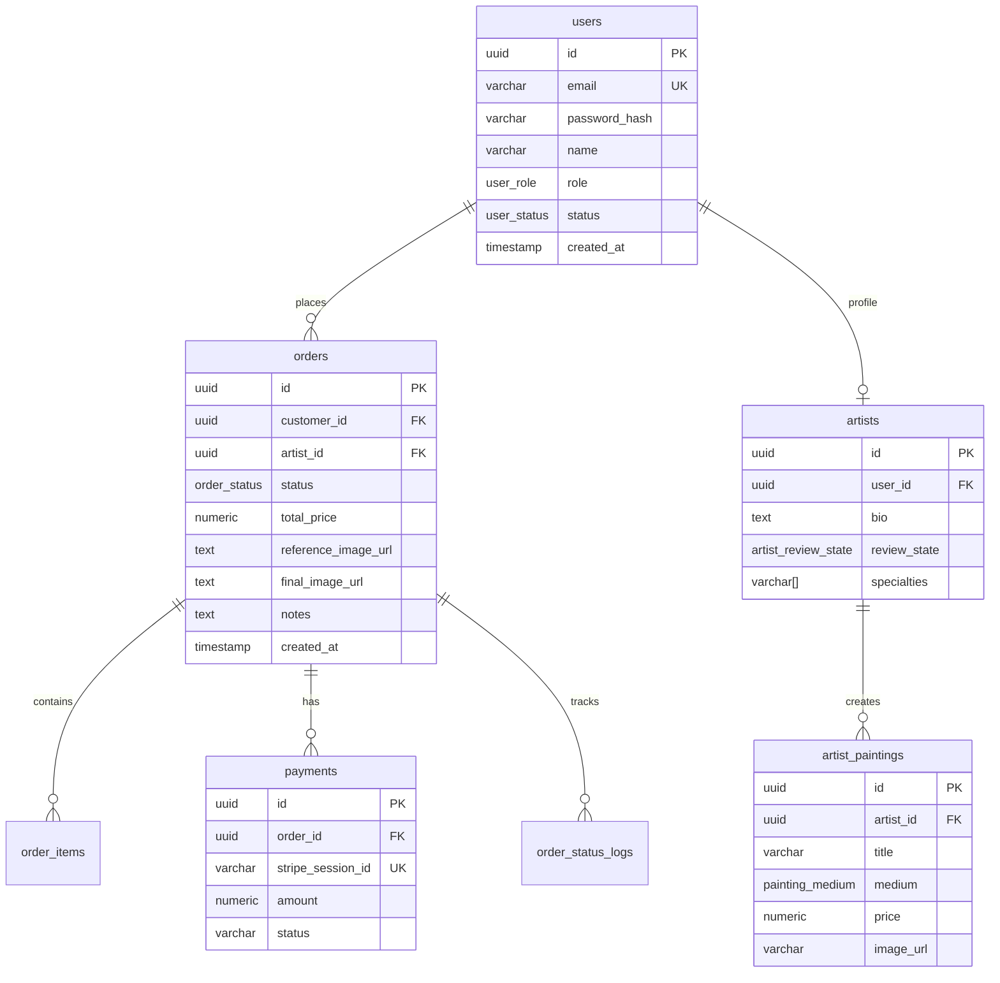

# Artify Platform &mdash; Functionality Guide

Comprehensive, end-to-end functionality documentation for the **Artify Platform**. This document details all features from user experience, business logic, API contracts, frontend components, and database schema perspectives.

---

## 📑 Table of Contents

1. [Architecture & System Overview](#1-architecture--system-overview)
2. [User Roles & Access Control (RBAC)](#2-user-roles--access-control-rbac)
3. [Authentication & Account Management](#3-authentication--account-management)
4. [Dynamic Artwork Gallery](#4-dynamic-artwork-gallery)
5. [Customer Reference Photo Uploader](#5-customer-reference-photo-uploader)
6. [Interactive Custom Order Wizard](#6-interactive-custom-order-wizard)
7. [Dynamic Pricing Engine](#7-dynamic-pricing-engine)
8. [Order Lifecycle & Tracking](#8-order-lifecycle--tracking)
9. [Artist Onboarding & Verification](#9-artist-onboarding--verification)
10. [Admin Order & Artist Management](#10-admin-order--artist-management)
11. [Payments & Checkout Integration](#11-payments--checkout-integration)
12. [File Storage (Local Disk & Cloud S3)](#12-file-storage-local-disk--cloud-s3)
13. [Database Schema & Migrations](#13-database-schema--migrations)

---

## 1. Architecture & System Overview

---

## 2. User Roles & Access Control (RBAC)

The platform enforces four distinct user roles defined in PostgreSQL enum `user_role`:

| Role | Permissions & Scope |
| :--- | :--- |
| **`CUSTOMER`** | Browse public gallery, estimate pricing, upload reference photos, create custom portrait orders, manage personal account, view personal order history, live delivery tracking, and download finished portraits. |
| **`ARTIST`** | Complete profile details, submit artwork portfolio for review, track verification status (`PENDING`, `UNDER_REVIEW`, `ACTIVE`), view assigned commission orders, upload completed artwork scans to auto-generate collage. |
| **`DELIVERY_AGENT`** | View assigned delivery parcels, update delivery transit states (`IN_TRANSIT`, `OUT_FOR_DELIVERY`, `DELIVERED`, `DELIVERY_FAILED` with retry logs), decline assignment back to studio if unavailable. |
| **`ADMIN`** | Access admin review queue, verify or reject artist profiles, view all platform customer orders, inspect completed collages, assign artists, assign delivery agents, confirm public gallery publication. |

---

## 3. Authentication & Account Management

### 3.1 Overview
Stateless JWT-based authentication. Passwords are encrypted using **bcrypt** (cost 12). Upon successful login or registration, the server issues a signed JWT containing `user_id`, `role`, and `status`.

### 3.2 Key Workflows
- **Customer Registration**: New customers register with `name`, `email`, and `password`. The account is created with role `CUSTOMER` and status `ACTIVE`.
- **Artist Registration**: Artists register with the same form; their initial review status is set to `PENDING`.
- **Guest Order Interception**: When unauthenticated visitors click *"Order Your Portrait"*, the system saves the selected artwork and medium in URL state, redirects them to `/login` or `/register`, and returns them directly to the Order Wizard upon login.

### 3.3 Endpoints
| Method | Endpoint | Request Body | Response |
| :--- | :--- | :--- | :--- |
| `POST` | `/auth/register` | `{ "name": "...", "email": "...", "password": "..." }` | `{ "token": "...", "user": { "id", "email", "name", "role" } }` |
| `POST` | `/auth/login` | `{ "email": "...", "password": "..." }` | `{ "token": "...", "user": { "id", "email", "name", "role" } }` |
| `GET` | `/api/me` | *Bearer Token Header* | `{ "user_id": "...", "role": "CUSTOMER", "status": "ACTIVE" }` |

---

## 4. Dynamic Artwork Gallery

### 4.1 Overview
The public gallery on the landing page showcases authentic handmade artwork. Unlike static galleries, this gallery is **100% database-driven** and dynamically incorporates both artist portfolio pieces and newly completed customer commissions.

> [!IMPORTANT]
> **Verified Artists Quality Rule**:
> To protect platform quality, paintings and completed orders are **only displayed if the completing artist is verified** (`artist_profiles.verified = TRUE`). Work created by unverified, pending, or rejected artist accounts is automatically excluded from the public gallery.

### 4.2 Authentic Medium Categorization
All 22 initial artworks seeded via migration `010_seed_gallery_paintings.up.sql` are classified by their true artistic medium:

| Category | Description | Seeded Artworks | Starting Price |
| :--- | :--- | :---: | :---: |
| **`PENCIL`** | Precision graphite sketches, fine cross-hatching, and realistic shading | 9 | ₹1,850 |
| **`CHARCOAL`** | Dramatic contrasts, deep charcoal blacks, and expressive blending | 9 | ₹2,400 |
| **`WATERCOLOR`** | Soft washes, vibrant blending, and fine portrait detail | 1 | ₹3,200 |
| **`ACRYLIC`** | Rich layered acrylic pigments on canvas board | 2 | ₹3,800 |
| **`OIL`** | Classic museum-grade oil portraits on stretched canvas | 1 | ₹5,500 |

### 4.3 UI & Aspect Ratio Optimization
- **1:1 Square Ratio (`aspect-square`)**: Each artwork in the original collection is formatted as a 1:1 square. Displaying them with a native 1:1 ratio eliminates horizontal clipping.
- **Corner Thumbnail Visibility**: Reference comparison photos embedded in the lower-left corners of sample artwork remain 100% visible.
- **Interactive Filtering**: Real-time category pills with badge counters (e.g. `Pencil (9)`, `Charcoal (9)`).

---

## 5. Customer Reference Photo Uploader

### 5.1 Overview
The [`PhotoUploader.tsx`](file:///d:/ArtifyMe/artify-platform/artifyme-frontend/src/components/PhotoUploader.tsx) component provides an intuitive file-upload experience across all devices.

### 5.2 Key Capabilities
- **Device File Picker**: Direct browsing from local mobile photo galleries, tablet files, laptop disks, or desktop directories.
- **Drag-and-Drop Zone**: Instant drop zone with visual hover states and feedback.
- **Client-Side Validation**:
  - Validates MIME types (`image/jpeg`, `image/png`, `image/webp`).
  - Enforces maximum file size limit (10MB).
  - Displays user-friendly error banners when invalid files are selected.
- **Live Thumbnail Preview**: Shows a high-definition preview of the selected image before submission, with a one-click *"Remove / Change"* button.

### 5.3 Backend File Processing (`files.Service`)
- Generates a cryptographically random UUID filename to prevent collisions.
- Stores files to `./uploads/<uuid>.<ext>` on local disk, or streams directly to S3 / MinIO when S3 credentials are configured.
- Returns a normalized public URL (`/uploads/<uuid>.<ext>`) stored in `orders.reference_image_url`.

---

## 6. Interactive Custom Order Wizard

### 6.1 Step-by-Step Flow

### 6.2 Configuration Options
1. **Medium**: Pencil, Charcoal, Watercolor, Acrylic, Oil.
2. **Paper / Canvas Dimensions**:
   - `A4` ($21 \times 29.7$ cm) &mdash; Standard personal portrait.
   - `A3` ($29.7 \times 42$ cm) &mdash; Double size, ideal for couples and framing.
   - `A2` ($42 \times 59.4$ cm) &mdash; Large format for family and statement portraits.
3. **Number of Subjects / Faces**:
   - `1 Face` (Base price)
   - `2 Faces` (+35% surcharge)
   - `3+ Faces` (+60% surcharge)
4. **Special Delivery / Framing Instructions**:
   - Optional text area for special requests (e.g., *"Please emphasize the eyes"*, *"Gift wrap for anniversary"*).

---

## 7. Dynamic Pricing Engine

The backend implements automated price estimation in [`orders.catalog`](file:///d:/ArtifyMe/artify-platform/artifyme-backend/cmd/internal/modules/orders/catalog.go).

$$\text{Final Price} = \text{Base Price}(\text{Medium}) \times \text{Size Multiplier} \times \text{Face Multiplier}$$

### Pricing Matrix
| Medium | Base Price (A4, 1 Face) | A3 Multiplier ($1.4\times$) | A2 Multiplier ($1.8\times$) |
| :--- | :---: | :---: | :---: |
| **Pencil** | ₹1,850 | ₹2,590 | ₹3,330 |
| **Charcoal** | ₹2,400 | ₹3,360 | ₹4,320 |
| **Watercolor** | ₹3,200 | ₹4,480 | ₹5,760 |
| **Acrylic** | ₹3,800 | ₹5,320 | ₹6,840 |
| **Oil** | ₹5,500 | ₹7,700 | ₹9,900 |

*Face Multipliers: 1 Face ($1.0\times$), 2 Faces ($1.35\times$), 3+ Faces ($1.6\times$).*

---

## 8. Order Lifecycle & Tracking

### 8.1 End-to-End Workflow Diagram

### 8.2 State Machine (All Roles)

### 8.3 Order Status Definitions & Role Permissions

| Status | Definition & Role Responsibility |
|---|---|
| **`PLACED`** | Customer created the commission with reference photo, medium, size, and face count. Awaiting payment verification. |
| **`CONFIRMED`** | Payment verified by Admin/gateway. Ready for studio artist assignment. |
| **`ASSIGNED_ARTIST`** | Admin assigned a verified portrait artist (`artist_profiles.verified = TRUE`). |
| **`IN_PROGRESS`** | Assigned artist started working on physical canvas/paper. |
| **`COMPLETED`** | Artist uploaded the finished portrait scan (`final_image_url`). System automatically generates a side-by-side comparison collage (`collage_image_url`). Artwork remains private (`is_published_to_gallery = false`). |
| **`ASSIGNED_DELIVERY_AGENT`** | Admin reviewed artwork and assigned an active delivery partner (`DELIVERY_AGENT`). |
| **`IN_TRANSIT`** | Delivery agent accepted parcel and dispatched from studio. |
| **`OUT_FOR_DELIVERY`** | Delivery agent is actively reaching the customer's doorstep. |
| **`DELIVERY_FAILED`** | Delivery attempt failed (customer unavailable, incorrect phone/address). Logs attempt counter (1-3) and failure reason. Can be re-attempted. |
| **`DELIVERED`** | Delivery agent confirmed physical handover at doorstep. |
| **`PUBLISHED`** | Admin reviewed delivered artwork and approved public showcase. `is_published_to_gallery = true`, promoting the artwork collage to the Public Art Gallery (`/gallery`). |
| **`CANCELLED`** | Order cancelled and archived. |

### 8.4 Verified Artist Order Assignment
> [!IMPORTANT]
> **Strict Verification Enforcement**:
> Customers' portrait sketch orders can **ONLY be assigned to verified artists** (`artist_profiles.verified = TRUE`).
> - **Who can assign**: Admins and verified Artists can assign orders.
> - **Assignment Endpoint**: `POST /api/v1/orders/:id/assign` with payload `{ "artist_id": "<uuid>" }`.
> - **Validation Rule**: If the target `artist_id` is unverified, missing, or belongs to an account with `verified = FALSE`, the system immediately rejects the assignment with `ErrArtistNotVerified` (`400 Bad Request`).
> - **Roster Discovery**: Verified artists and admins can discover assignable talent via `GET /api/v1/artists/verified`.

### 8.5 Customer Account Screen ([`AccountPage.tsx`](file:///d:/ArtifyMe/artify-platform/artifyme-frontend/src/pages/AccountPage.tsx))
- Lists all active and past orders placed by the customer.
- Displays thumbnail of the uploaded reference photo.
- Color-coded status badge and creation timestamp.
- Direct link to view/download high-resolution final portrait once `COMPLETED`.

---

## 9. Artist Onboarding & Verification

### 9.1 Flow
1. Artist registers via `/auth/register` with role `ARTIST`.
2. Artist updates profile details via `POST /api/artist/profile` (bio, portfolio links, years of experience, preferred mediums).
3. Initial review status is set to `PENDING`.
4. Artist uploads initial sample paintings via `POST /api/artist/paintings/add`.
5. Profile enters the Admin Review Queue (`UNDER_REVIEW`).
6. Upon approval, artist status changes to `ACTIVE`.

### 9.2 Endpoints
- `GET /api/artist/profile/view` &mdash; View own profile and review state.
- `POST /api/artist/profile` &mdash; Create or update artist bio and details.
- `GET /api/artist/paintings/` &mdash; View artist's uploaded paintings.
- `POST /api/artist/paintings/add` &mdash; Upload new artwork to artist portfolio.

---

## 10. Admin Order & Artist Management

### 10.1 Admin Portal Web Application (`/admin`)
The platform includes a dedicated **Admin Dashboard** ([`AdminPage.tsx`](file:///d:/ArtifyMe/artify-platform/artifyme-frontend/src/pages/AdminPage.tsx)) accessible to users with the `ADMIN` role:
- **Automatic Navigation**: Logging in with an admin account (`ganesh@example.com`) automatically directs the user to `/admin`.
- **Admin Navigation Badge**: A prominent `🛡️ Admin Portal` pill appears in the top navigation bar when authenticated as an Admin.
- **Route Guarding**: Protected by `<AdminRoute>`, redirecting unauthenticated or non-admin users to `/`.
- **Top Stats Bar**: Real-time counters for total platform orders, pending artist review queue items, and verified artists.

### 10.2 Artist Review & Verification
- **Endpoint**: `GET /api/admin/artists/review-queue` (requires `ADMIN` role).
- Admins review pending artist submissions, inspecting uploaded portfolio samples and bios.
- **Approval**: `POST /api/admin/verify-artist/:id` sets review state to `ACTIVE` and verified status to `true`.
- **Rejection**: `POST /api/admin/reject-artist/:id` sets review state to `REJECTED` with mandatory constructive feedback.

### 10.3 Order Management & Assignment
- **Endpoint**: `GET /api/v1/admin/orders` &mdash; Lists all orders across all customers with status filtering (`ALL`, `PLACED`, `CONFIRMED`, `ASSIGNED_ARTIST`, `IN_PROGRESS`, `COMPLETED`, `CANCELLED`).
- **Assign to Verified Artist**: One-click dropdown modal selecting from verified artists (`GET /api/v1/artists/verified`) and assigning via `POST /api/v1/orders/:id/assign`.
- **Status Lifecycle Control**:
  - `Confirm Order`: Transitions `PLACED` &rarr; `CONFIRMED`.
  - `Start Drawing`: Transitions `CONFIRMED`/`ASSIGNED_ARTIST` &rarr; `IN_PROGRESS`.
  - `Complete & Publish`: Submits `final_image_url` and transitions order to `COMPLETED`, **automatically publishing the artwork to the public gallery**.
  - `Cancel Order`: Transitions order to `CANCELLED`.
- **Audit Logging**: Every status transition automatically writes a record into `order_status_logs`.

- Status update logs an entry into the `order_status_logs` audit table.

---

## 11. Payments & Checkout Integration

### 11.1 Architecture
The platform is designed to support **Stripe Checkout**:
- `POST /api/v1/orders/:id/checkout` initiates a checkout session.
- Stored in the `payments` table with `order_id`, `stripe_session_id`, `amount`, and `status`.

### 11.2 Development Mode (Mock Checkout)
When `STRIPE_SECRET_KEY` is not set in `.env`:
- The backend generates a deterministic session ID (`dev_session_<order_id>`).
- Automatically routes the customer to the success URL (`/order/success?order_id=...`).
- Allows complete end-to-end testing of customer ordering without third-party API dependencies.

### 11.3 Production Stripe Webhook
- Endpoint: `POST /webhooks/stripe`
- Listens for `checkout.session.completed` events, verifies Stripe signatures, and automatically transitions orders to `CONFIRMED`.

---

## 12. File Storage (Local Disk & Cloud S3)

The backend provides dual-mode file storage via [`files.Service`](file:///d:/ArtifyMe/artify-platform/artifyme-backend/cmd/internal/modules/files/service.go):

| Storage Mode | Active When | Storage Destination | Access URL |
| :--- | :--- | :--- | :--- |
| **Local Disk** | `S3_ENDPOINT` is unset or MinIO is offline | `./uploads/` directory | `http://localhost:8080/uploads/<filename>` |
| **S3 / MinIO** | `S3_ENDPOINT` & AWS credentials configured | Configured S3 bucket | S3 presigned URL or public CDN URL |

Both modes automatically ensure directories/buckets exist on startup and handle proper MIME headers.

---

## 13. Database Schema & Migrations

The database is built on PostgreSQL with strict referential integrity, foreign key constraints, and enum types.

### 13.1 Schema Overview

### 13.2 Migration History

| Version | Migration Name | Key Schema Changes |
| :---: | :--- | :--- |
| `001` | `init_schema` | Creates `users`, `artists`, `orders`, `order_items`, `reviews`, and base enums. |
| `002` | `add_artist_review_states` | Introduces `artist_review_state` enum (`PENDING`, `UNDER_REVIEW`, `ACTIVE`, `REJECTED`). |
| `003` | `remove_timestamp_defaults_and_triggers` | Standardizes timestamp and trigger handling. |
| `004` | `add_indexes` | Performance indexes on `orders(customer_id)`, `orders(status)`, and foreign keys. |
| `005` | `log_order_status_change` | Creates `order_status_logs` audit trail table for tracking all lifecycle transitions. |
| `006` | `update_user_name` | Name formatting and constraint adjustments. |
| `007` | `calculate_order_total_price` | Dynamic pricing calculation functions. |
| `008` | `payments_and_order_notes` | Adds `payments` table, `notes` column to orders, and unique Stripe session index. |
| `009` | `restore_orders_timestamp_defaults` | Restores `DEFAULT NOW()` for `created_at` and `updated_at` on orders. |
| `010` | `seed_gallery_paintings` | Seeds 22 authentic paintings into `artist_paintings` with verified categories (Pencil: 9, Charcoal: 9, Watercolor: 1, Acrylic: 2, Oil: 1). |

---

## 🎯 Summary Checklist

- [x] **JWT Auth & RBAC** (Customer, Artist, Admin)
- [x] **Dynamic Gallery** (DB-driven, unites artist portfolio + completed orders)
- [x] **Categorization** (Pencil, Charcoal, Watercolor, Acrylic, Oil)
- [x] **1:1 Aspect Ratio** (Eliminates cropping of original artwork and corner reference photos)
- [x] **Device Photo Uploader** (Browse files from phone/laptop/desktop + drag-and-drop)
- [x] **Multi-Step Order Wizard** (Size, Medium, Number of Faces, Delivery notes)
- [x] **Live Dynamic Pricing Engine** (Calculates price in real time based on dimensions and subjects)
- [x] **Guest Order Redirect Flow** (Seamless login/register redirection while preserving order intent)
- [x] **Customer Order Tracking** (Visual status badges and finished artwork download)
- [x] **Dual Storage Engine** (Local disk fallback and S3/MinIO cloud support)
- [x] **Embedded Auto-Migrations** (001 to 010 run automatically on server boot)
- [x] **Interactive Swagger Docs** (Available at `/swagger/index.html`)
